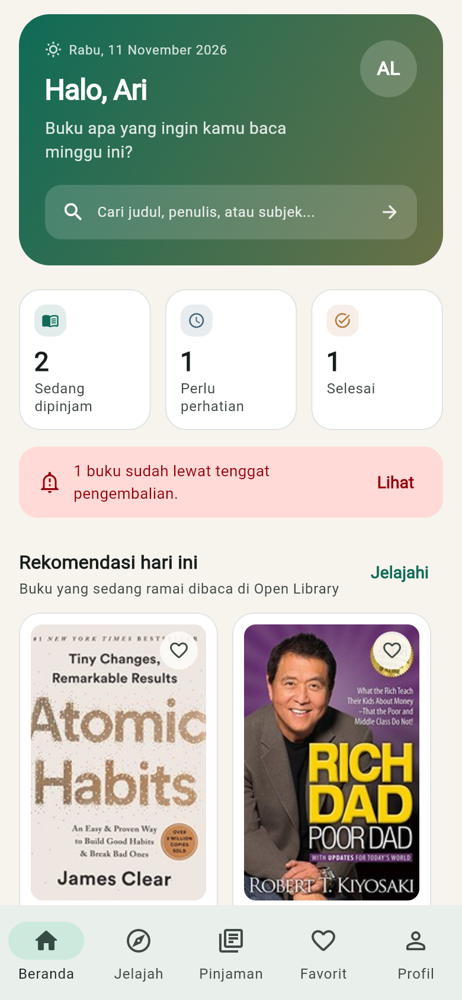
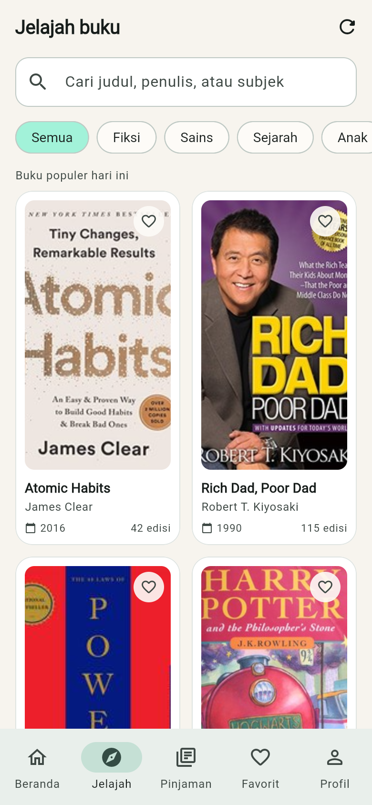
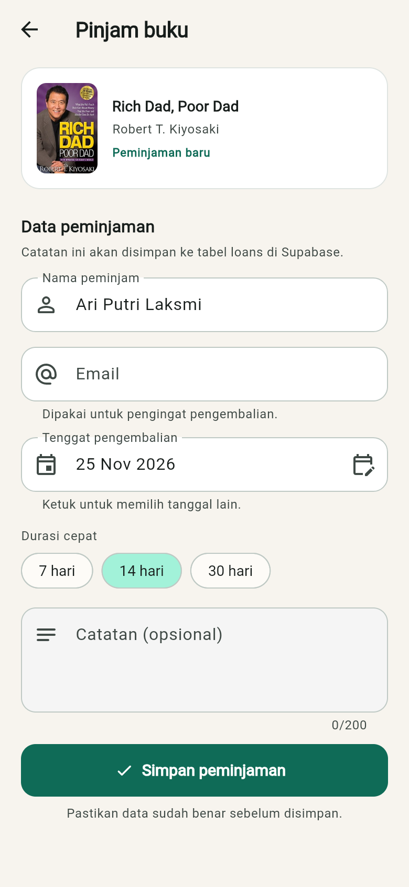
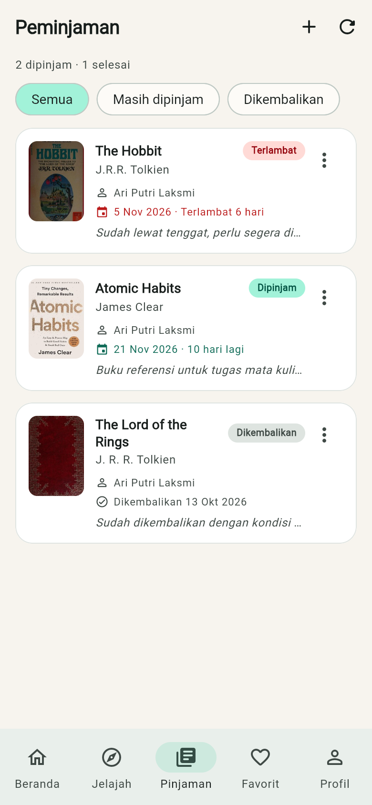
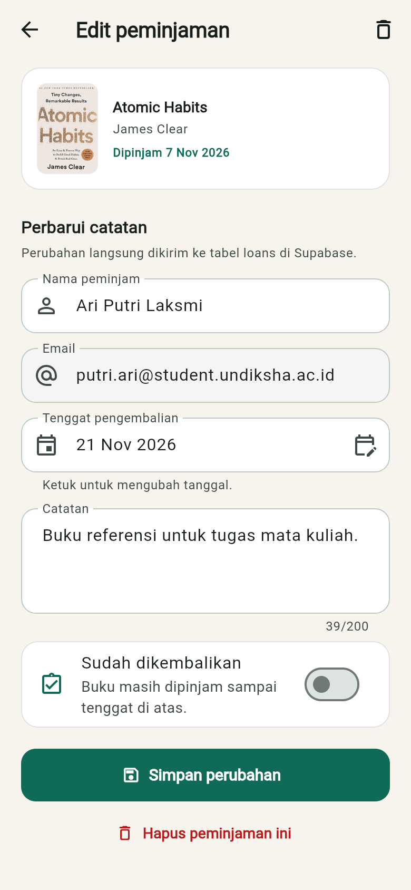
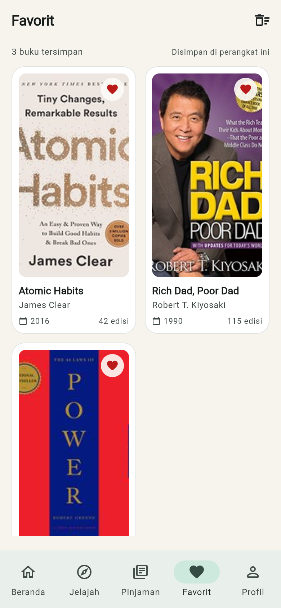
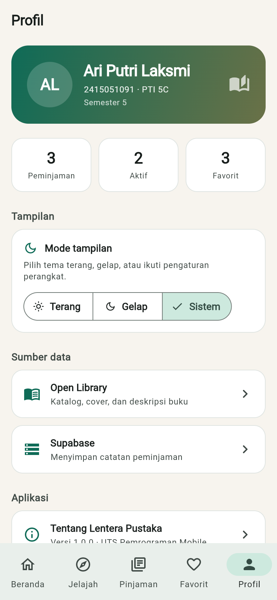
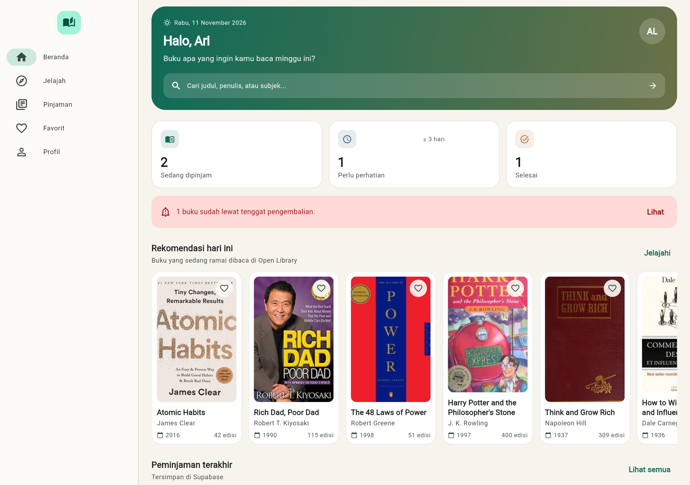

# Lentera Pustaka

Aplikasi mobile Flutter untuk mencari buku di Open Library, menyimpan buku favorit, dan mencatat peminjaman buku pribadi di Supabase. Project ini dibuat untuk UTS mata kuliah Pemrograman Mobile.

| | |
|---|---|
| **Nama** | Ari Putri Laksmi |
| **NIM** | 2415051091 |
| **Kelas** | PTI 5C |
| **Semester** | 5 |
| **Tema Project** | Sistem peminjaman buku |
| **Branch utama** | `main` |

## Deskripsi

Lentera Pustaka memisahkan dua jenis data. Katalog buku, cover, dan deskripsi diambil langsung dari REST API Open Library. Catatan peminjaman seperti nama peminjam, tanggal pinjam, tenggat, status, dan catatan pribadi disimpan di database Supabase.

Dengan pemisahan ini, aplikasi tidak menyimpan salinan katalog. Data pribadi tetap tersimpan walaupun katalog Open Library berubah.

## Fitur

- **Beranda** berisi sapaan, statistik peminjaman, pencarian cepat, rekomendasi buku harian, dan peminjaman terakhir.
- **Katalog buku** dengan pencarian judul/penulis, filter kategori, grid responsif, dan tombol muat lebih banyak.
- **Detail buku** dengan cover, penulis, tahun terbit, subjek, deskripsi dari Open Library, status ketersediaan, dan tombol pinjam.
- **Form peminjaman** dengan validasi nama, email, tenggat pengembalian, durasi cepat, dan catatan.
- **Daftar peminjaman** dari Supabase dengan filter semua/aktif/dikembalikan, indikator terlambat, dan tenggat terdekat.
- **Edit peminjaman** untuk mengubah peminjam, email, tenggat, catatan, dan status pengembalian.
- **Hapus peminjaman** memakai dialog konfirmasi sebelum data dihapus dari database.
- **Favorit** sebagai shared state yang bisa dibuka dari beranda, katalog, detail, dan halaman favorit.
- **Profil** berisi identitas mahasiswa, statistik, sumber data, dan pengaturan tema terang/gelap/sistem.
- **Feedback** berupa SnackBar untuk setiap aksi penting dan dialog untuk konfirmasi.
- **Loading, error, dan empty state** pada seluruh layar yang mengambil data.
- **Layout responsif** dengan NavigationBar untuk layar kecil dan NavigationRail untuk layar lebar.

## Daftar Screen

| No | Screen | Berkas |
|---|---|---|
| 1 | Beranda / Dashboard | `lib/screens/home_screen.dart` |
| 2 | Jelajah / Katalog | `lib/screens/explore_screen.dart` |
| 3 | Detail Buku | `lib/screens/book_detail_screen.dart` |
| 4 | Pinjam Buku (Create) | `lib/screens/create_loan_screen.dart` |
| 5 | Peminjaman (Read) | `lib/screens/loans_screen.dart` |
| 6 | Edit Peminjaman (Update) | `lib/screens/edit_loan_screen.dart` |
| 7 | Favorit | `lib/screens/favorites_screen.dart` |
| 8 | Profil / About | `lib/screens/profile_screen.dart` |

## Tech Stack

- Flutter 3.47 dan Dart 3.13
- `provider` untuk state management `ChangeNotifier`
- `http` untuk REST API Open Library
- `supabase_flutter` untuk database PostgreSQL
- `intl` untuk format tanggal Bahasa Indonesia
- Material 3 dengan tema terang dan gelap

## REST API

Base URL: `https://openlibrary.org`

| Fungsi | Endpoint | Keterangan |
|---|---|---|
| Pencarian buku | `GET /search.json?q={query}&page={page}&limit={limit}&fields=...` | Mengembalikan daftar `docs` yang dipetakan ke model `Book` |
| Rekomendasi harian | `GET /trending/daily.json?limit=12` | Dipakai di beranda |
| Detail buku | `GET /works/{id}.json` | Deskripsi, subjek, dan tanggal terbit pertama |
| Cover buku | `GET https://covers.openlibrary.org/b/id/{cover_id}-{S/M/L}.jpg` | Gambar cover |

Semua pemanggilan API dilakukan lewat `OpenLibraryService`, bukan langsung dari widget.

## Backend dan Database

Supabase PostgreSQL, tabel utama `public.loans`.

| Kolom | Tipe | Keterangan |
|---|---|---|
| `id` | `uuid` | Primary key, default `gen_random_uuid()` |
| `book_key` | `text` | Kunci work Open Library, contoh `/works/OL17930368W` |
| `title` | `text` | Judul buku |
| `author` | `text` | Penulis |
| `cover_id` | `integer` | ID cover Open Library |
| `borrower_name` | `text` | Nama peminjam, minimal 3 karakter |
| `borrower_email` | `text` | Email untuk pengingat |
| `borrowed_at` | `date` | Tanggal mulai pinjam |
| `due_date` | `date` | Tenggat pengembalian |
| `returned_at` | `date` | Tanggal dikembalikan |
| `status` | `text` | `borrowed` atau `returned` |
| `notes` | `text` | Catatan, maksimal 200 karakter |
| `created_at` | `timestamptz` | Waktu data dibuat |
| `updated_at` | `timestamptz` | Diperbarui otomatis oleh trigger |

Operasi CRUD yang dipakai aplikasi:

- **Create** saat menyimpan peminjaman baru dari halaman detail buku.
- **Read** saat memuat beranda, daftar peminjaman, dan statistik.
- **Update** saat mengedit peminjaman atau menandai buku sudah dikembalikan.
- **Delete** saat menghapus peminjaman setelah dialog konfirmasi.

Skema lengkap, trigger, policy RLS, dan data demo ada di [`supabase/schema.sql`](supabase/schema.sql).

## Struktur Arsitektur

```
lib/
├── core/
│   ├── config/supabase_config.dart
│   ├── constants/app_info.dart
│   ├── theme/app_theme.dart
│   └── utils/ (breakpoints, formatters, feedback, loan_actions)
├── models/        Book, BookDetail, BookCategory, Loan
├── services/      OpenLibraryService, LoanService, AppException
├── repositories/  BookRepository, LoanRepository
├── providers/     BookProvider, LoanProvider, FavoriteProvider, ThemeProvider
├── screens/       8 screen fungsional
├── widgets/       BookCard, BookGrid, LoanCard, StatCard, StateView, AppShell, dll.
├── app.dart
└── main.dart
```

Alur data: **UI → Provider → Repository → Service → REST API / Supabase**. Screen tidak memanggil HTTP atau query database secara langsung.

## Screenshot

| Beranda | Katalog |
|---|---|
|  |  |

| Detail Buku | Form Peminjaman |
|---|---|
|  |  |

| Daftar Peminjaman | Edit Peminjaman |
|---|---|
|  |  |

| Favorit | Profil |
|---|---|
|  |  |

| Layout lebar (NavigationRail) |
|---|
|  |

## Cara Menjalankan

### Prasyarat

- Flutter 3.47 atau lebih baru
- Akun Supabase dan project aktif
- Emulator Android atau perangkat fisik

### 1. Ambil source code

```bash
git clone https://github.com/putriari93/uts_flutter_ui_fundamentals.git
cd uts_flutter_ui_fundamentals
flutter pub get
```

### 2. Siapkan database

1. Buka Supabase Dashboard, pilih project.
2. Masuk ke **SQL Editor**.
3. Salin seluruh isi `supabase/schema.sql`, jalankan.
4. Pastikan tabel `public.loans` muncul di **Table Editor**.

Script tersebut juga mengaktifkan RLS dan membuat policy untuk role `anon`. Data contoh ikut dimasukkan agar halaman peminjaman langsung terisi.

### 3. Konfigurasi koneksi

URL dan publishable key sudah diatur di `lib/core/config/supabase_config.dart`.

```dart
static const String url = 'https://qgvqssnxqnuuwwodbptv.supabase.co';
static const String publishableKey = 'sb_publishable_...';
```

Gunakan key milik project sendiri bila ingin menjalankan versi terpisah. Jangan pernah menaruh service role key di aplikasi.

### 4. Jalankan aplikasi

```bash
flutter run
```

### 5. Build APK

```bash
flutter build apk --release
```

Hasil build ada di `build/app/outputs/flutter-apk/app-release.apk`.

## Pengujian

```bash
flutter analyze
flutter test
```

Test yang tersedia mencakup parsing data Open Library, konversi baris Supabase menjadi model `Loan`, format tanggal payload database, dan perhitungan status terlambat.

## Keamanan

- Aplikasi hanya memakai **publishable key**, bukan service role key.
- RLS aktif pada tabel `loans`.
- Policy saat ini terbuka untuk role `anon` karena aplikasi belum memiliki autentikasi. Untuk produksi, ganti policy dengan aturan berbasis `auth.uid()`.
- Tidak ada password, token rahasia, atau keystore yang di-commit.

## Catatan Pengembangan

Project dikembangkan bertahap dengan commit kecil yang menjelaskan pekerjaan, misalnya penambahan model, service, repository, provider, layar, sampai dokumentasi. Riwayat lengkap dapat dilihat dengan:

```bash
git log --oneline
```

## Dokumentasi Tambahan

Penjelasan arsitektur, alur state, dan daftar requirement ada di [`docs/DOKUMENTASI.md`](docs/DOKUMENTASI.md).
