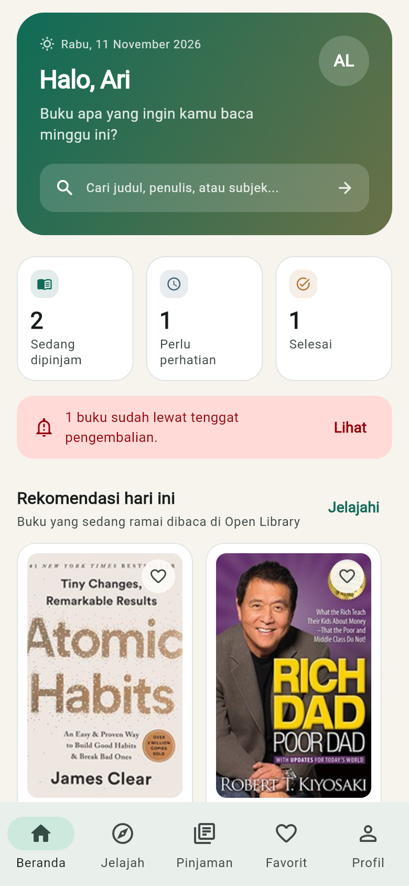
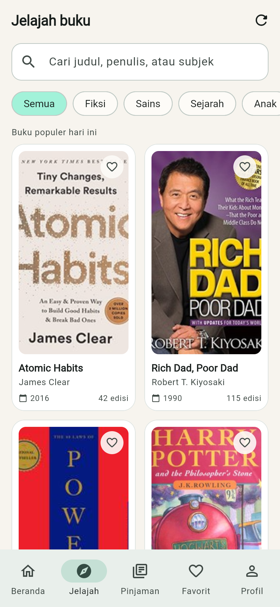
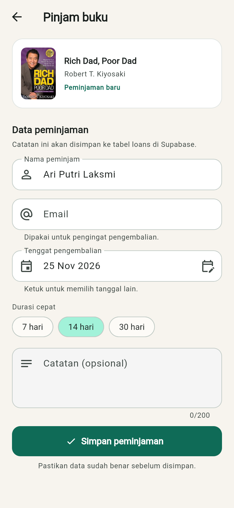
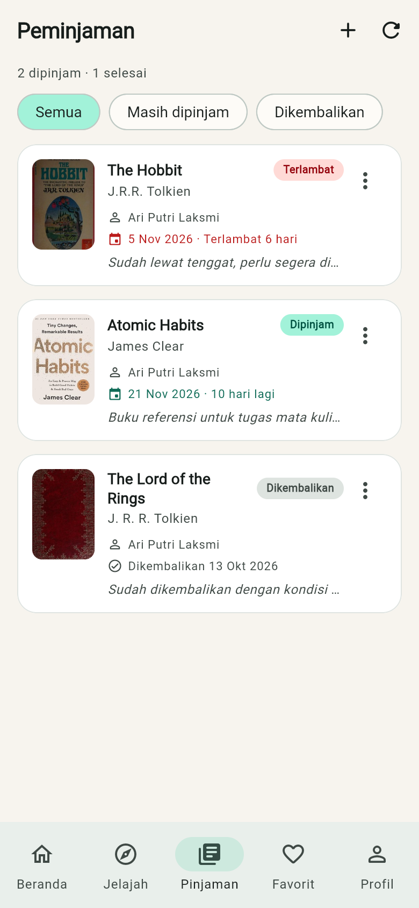
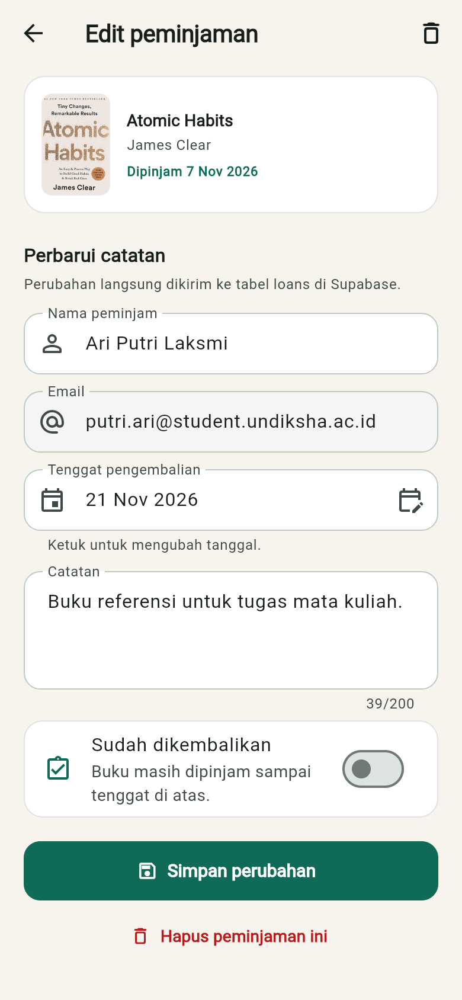
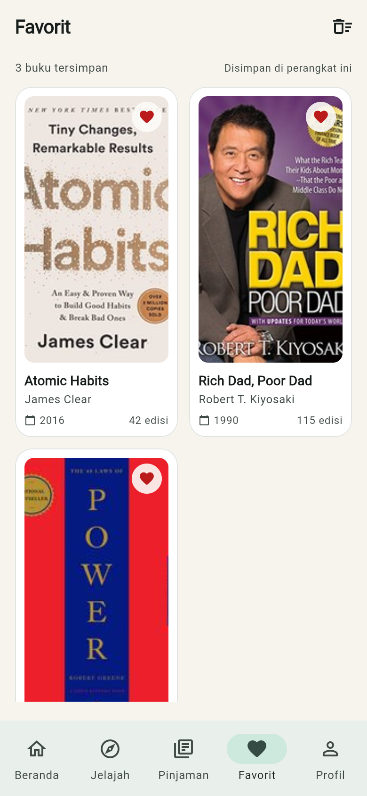
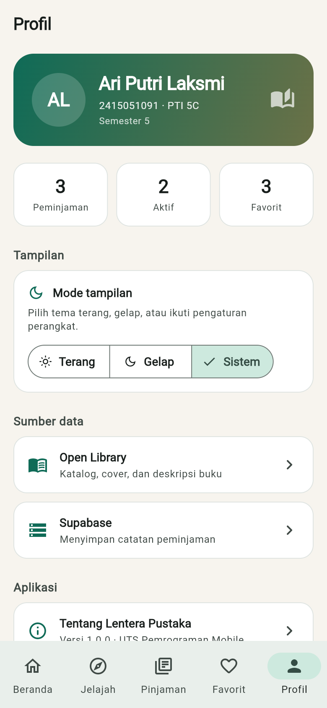
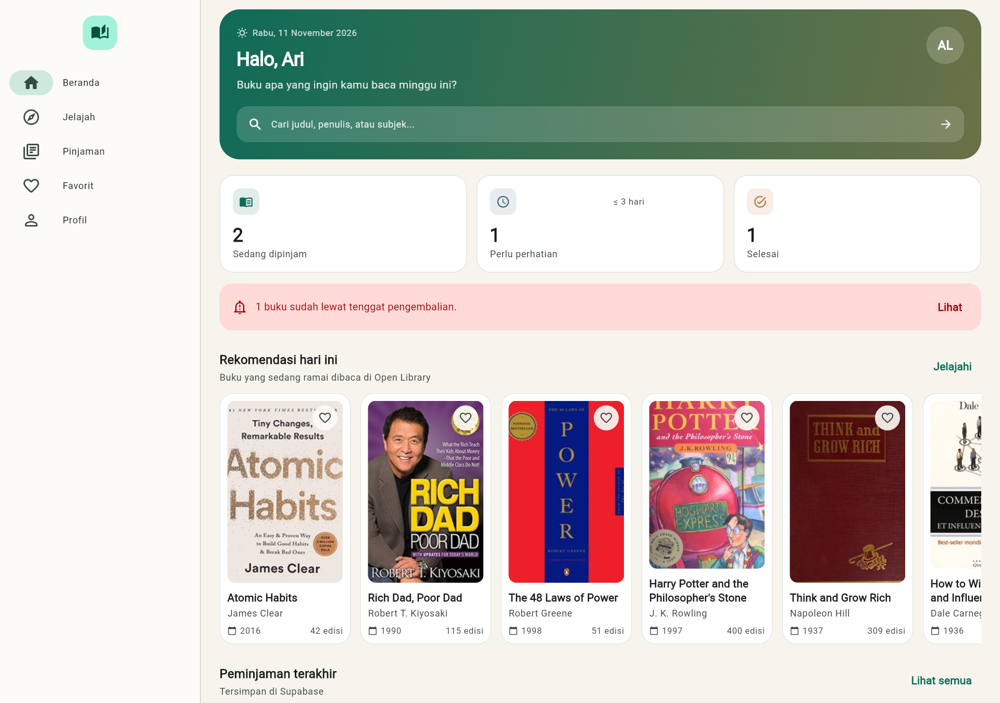

# Dokumentasi Project Lentera Pustaka

## 1. Identitas

| | |
|---|---|
| Nama | Ari Putri Laksmi |
| NIM | 2415051091 |
| Kelas | PTI 5C |
| Semester | 5 |
| Mata kuliah | Pemrograman Mobile |
| Nama project | Lentera Pustaka |
| Tema | Sistem peminjaman buku |
| Branch utama | `main` |

## 1a. Bukti Pengumpulan

| Item | Keterangan |
|---|---|
| Repository | https://github.com/putriari93/UTS_2415051091_Ari_Putri_Laksmi |
| Riwayat commit | https://github.com/putriari93/UTS_2415051091_Ari_Putri_Laksmi/commits/main |
| APK | `UTS_2415051091_Ari Putri Laksmi.apk` |
| Dokumentasi | `UTS_2415051091_Ari Putri Laksmi.pdf` |
| Screenshot | Folder `docs/screenshots/` berisi 9 gambar |

Bukti `git log --oneline` disertakan pada lampiran PDF dokumentasi ini.

## 2. Gambaran Aplikasi

Lentera Pustaka adalah aplikasi Flutter untuk mengelola peminjaman buku pribadi. Katalog buku diambil dari Open Library, sedangkan catatan peminjaman disimpan di Supabase.

Pembagian peran data:

- **Open Library** menyediakan katalog, cover, penulis, tahun terbit, subjek, dan deskripsi. Data ini hanya dibaca.
- **Supabase** menyimpan data milik pengguna: nama peminjam, email, tanggal pinjam, tenggat, status, dan catatan.

Dengan pembagian tersebut, aplikasi tidak perlu menyimpan ulang katalog, tetapi tetap memiliki data pribadi yang bisa diubah dan dihapus.

## 3. Arsitektur

```
main.dart
  └── LenteraApp (MultiProvider)
        └── AppShell (NavigationBar / NavigationRail)
              ├── HomeScreen
              ├── ExploreScreen
              ├── LoansScreen
              ├── FavoritesScreen
              └── ProfileScreen

UI (screen/widget)
  ↓ watch / read
Provider (ChangeNotifier)
  ↓
Repository
  ↓
Service
  ├── http → Open Library REST API
  └── SupabaseClient → PostgreSQL
```

Aturan yang diterapkan:

1. Screen tidak memanggil `http` atau `SupabaseClient` secara langsung.
2. Service hanya menangani komunikasi data dan penerjemahan error.
3. Repository menjadi pintu masuk data untuk provider.
4. Provider menyimpan state yang dipakai bersama antar-screen.
5. Widget reusable dipisahkan dari screen.

### Struktur folder

```
lib/
├── core/
│   ├── config/supabase_config.dart
│   ├── constants/app_info.dart
│   ├── theme/app_theme.dart
│   └── utils/
│       ├── breakpoints.dart
│       ├── feedback.dart
│       ├── formatters.dart
│       └── loan_actions.dart
├── models/
│   ├── book.dart
│   ├── book_category.dart
│   ├── book_detail.dart
│   └── loan.dart
├── services/
│   ├── app_exception.dart
│   ├── loan_service.dart
│   └── open_library_service.dart
├── repositories/
│   ├── book_repository.dart
│   └── loan_repository.dart
├── providers/
│   ├── book_provider.dart
│   ├── favorite_provider.dart
│   ├── loan_provider.dart
│   └── theme_provider.dart
├── screens/
│   ├── home_screen.dart
│   ├── explore_screen.dart
│   ├── book_detail_screen.dart
│   ├── create_loan_screen.dart
│   ├── loans_screen.dart
│   ├── edit_loan_screen.dart
│   ├── favorites_screen.dart
│   └── profile_screen.dart
├── widgets/
│   ├── app_shell.dart
│   ├── book_card.dart
│   ├── book_cover.dart
│   ├── book_grid.dart
│   ├── content_container.dart
│   ├── loan_card.dart
│   ├── section_header.dart
│   ├── state_view.dart
│   └── stat_card.dart
├── app.dart
└── main.dart
```

## 4. State Management

Empat provider dipakai dengan `ChangeNotifier`:

### BookProvider

- Menyimpan daftar buku katalog, rekomendasi, kategori aktif, kata kunci, dan status pagination.
- Mengelola `isLoading`, `error`, `loadMoreError`, serta cache `Future<BookDetail>`.
- Pencarian memakai debounce 500 ms di layar katalog.
- Filter kategori menjadi shared state antara layar katalog dan tampilan hasil.

### LoanProvider

- Sumber data untuk beranda, daftar peminjaman, detail buku, dan form.
- Menyimpan `loans`, `isLoading`, `isSaving`, dan `error`.
- Menyediakan statistik: jumlah aktif, selesai, terlambat, dan yang mendekati tenggat.
- Setiap operasi create/update/delete langsung memperbarui daftar lokal setelah database merespons.

### FavoriteProvider

- Menyimpan buku favorit di memori aplikasi sebagai shared state.
- Dipakai di beranda, katalog, detail, dan halaman favorit.

### ThemeProvider

- Menyimpan pilihan tema terang, gelap, atau mengikuti sistem.
- Diterapkan lewat `MaterialApp.themeMode`.

## 5. REST API

Semua request melewati `OpenLibraryService` dengan timeout 20 detik dan pesan error yang ramah.

| Fungsi | Endpoint |
|---|---|
| Pencarian | `https://openlibrary.org/search.json?q={query}&page={page}&limit={limit}&fields=key,title,author_name,first_publish_year,cover_i,edition_count,subject,language,ebook_access` |
| Rekomendasi | `https://openlibrary.org/trending/daily.json?limit=12` |
| Detail work | `https://openlibrary.org/works/{id}.json` |
| Cover | `https://covers.openlibrary.org/b/id/{cover_id}-M.jpg` |

Contoh pemetaan JSON ke model:

```dart
factory Book.fromSearchJson(Map<String, dynamic> json) {
  return Book(
    key: json['key'] as String? ?? '',
    title: (json['title'] as String?)?.trim() ?? 'Tanpa judul',
    authors: _stringList(json['author_name']),
    firstPublishYear: _asInt(json['first_publish_year']),
    coverId: _asInt(json['cover_i']),
    subjects: _stringList(json['subject']),
    language: _firstString(json['language']),
  );
}
```

Penanganan error mencakup timeout, koneksi gagal, status HTTP bukan 200, dan JSON yang tidak valid. Setiap kondisi diterjemahkan menjadi pesan yang bisa ditampilkan ke pengguna.

## 6. Database

Tabel `public.loans` memiliki 14 kolom: `id`, `book_key`, `title`, `author`, `cover_id`, `borrower_name`, `borrower_email`, `borrowed_at`, `due_date`, `returned_at`, `status`, `notes`, `created_at`, dan `updated_at`.

Fitur database:

- Primary key `uuid` dengan `gen_random_uuid()`.
- Constraint status hanya `borrowed` atau `returned`.
- Constraint panjang nama peminjam minimal 3 karakter dan catatan maksimal 200 karakter.
- Index pada `status`, `book_key`, dan `due_date`.
- Trigger `loans_set_updated_at` memperbarui `updated_at`.
- RLS aktif dengan policy untuk role `anon`.

Skema dijalankan sekali melalui SQL Editor Supabase. File: `supabase/schema.sql`.

## 7. Alur CRUD

### Create

1. Pengguna membuka detail buku.
2. Menekan **Pinjam buku ini**.
3. Form diisi: nama, email, tenggat, catatan.
4. Validasi berjalan sebelum submit.
5. `LoanProvider.create` memanggil `LoanRepository.create`, lalu `LoanService` melakukan insert ke Supabase.
6. SnackBar sukses muncul dan pengguna kembali ke detail.

### Read

1. Saat aplikasi dibuka, `LoanProvider.load()` mengambil seluruh baris tabel.
2. Beranda menampilkan statistik dan tiga peminjaman terakhir.
3. Halaman peminjaman menampilkan seluruh data dengan filter dan pengurutan berdasarkan tenggat.

### Update

1. Kartu peminjaman ditekan atau menu **Edit** dipilih.
2. Form edit terisi data lama.
3. Pengguna bisa mengubah peminjam, email, tenggat, catatan, dan status pengembalian.
4. `LoanProvider.update` mengirim perubahan dan mengganti item di daftar lokal.

### Delete

1. Menu **Hapus** dipilih dari kartu atau halaman edit.
2. Dialog konfirmasi muncul dengan nama buku.
3. Setelah dikonfirmasi, `LoanProvider.delete` menghapus baris dan memperbarui daftar.

## 8. Responsive Layout

Breakpoint ada di `lib/core/utils/breakpoints.dart`.

- Lebar di bawah 700 px dianggap compact.
- Lebar 700–1100 px dianggap medium.
- Lebih dari 1100 px dianggap expanded.

Penerapan:

- `NavigationBar` di bagian bawah untuk layar kecil.
- `NavigationRail` di sisi kiri untuk layar 900 px ke atas, dan versi extended untuk 1150 px ke atas.
- Grid buku berubah dari 2 kolom menjadi 3–6 kolom sesuai lebar.
- Daftar peminjaman berubah dari satu kolom menjadi dua kolom pada lebar 900 px ke atas.
- Detail buku berubah dari susunan vertikal menjadi dua kolom (cover dan informasi) pada lebar 860 px ke atas.
- Padding halaman menyesuaikan lebar layar.

## 9. Form dan Validasi

Form peminjaman dan edit memakai `Form` dan `GlobalKey<FormState>`.

Validasi yang diterapkan:

- Nama peminjam wajib diisi dan minimal 3 karakter.
- Email wajib diisi dengan format yang benar.
- Tenggat pengembalian tidak boleh di masa lalu.

Umpan balik:

- Pesan error muncul langsung di bawah field.
- SnackBar sukses atau gagal untuk operasi database.
- AlertDialog untuk konfirmasi hapus dan pengosongan favorit.
- Tombol submit berubah menjadi indikator loading selama proses simpan.

## 10. Reusable Widget

| Widget | Fungsi |
|---|---|
| `AppShell` | Navigasi utama responsif |
| `BookCard` | Kartu buku untuk grid dan daftar horizontal |
| `BookListTile` | Varian baris buku |
| `BookGrid` | Grid responsif dengan jumlah kolom otomatis |
| `BookCover` | Cover dengan placeholder, loading, dan error |
| `LoanCard` | Kartu peminjaman beserta status dan menu aksi |
| `StatCard` | Kartu statistik beranda |
| `StateView` | Tampilan loading/error/empty yang seragam |
| `SectionHeader` | Judul bagian dengan aksi |
| `ContentContainer` | Pembatas lebar konten |

## 11. Pemenuhan Requirement

| Komponen | Minimum | Implementasi |
|---|---|---|
| Screen fungsional | ≥ 6 | 8 screen |
| Dart Model | ≥ 2 | `Book`, `BookDetail`, `BookCategory`, `Loan` |
| Reusable widget | ≥ 3 | 10 widget |
| Responsive condition | ≥ 2 | Compact, medium, expanded |
| REST API | ≥ 1 | Open Library |
| REST GET | Wajib | Pencarian, rekomendasi, detail |
| Backend database | ≥ 1 | Supabase PostgreSQL |
| Tabel database | ≥ 1 | `public.loans` |
| Field tabel | ≥ 4 + ID | 14 kolom |
| CRUD database | 4 operasi | Create, Read, Update, Delete |
| State management | Provider | 4 `ChangeNotifier` |
| Multi-screen navigation | Wajib | NavigationBar dan NavigationRail |
| Passing data | Wajib | `Book` ke detail dan form, `Loan` ke edit |
| Form + validation | Wajib | Form pinjam dan edit |
| SnackBar/Dialog | Wajib | SnackBar, AlertDialog, date picker |
| Loading state | Wajib | Semua layar data |
| Error state | Wajib | API dan database |
| Empty state | Wajib | Katalog, peminjaman, favorit |
| Git commit | ≥ 16 | Commit bertahap dengan pesan deskriptif |

## 12. Screenshot

| Beranda | Katalog |
|---|---|
|  |  |

| Detail Buku | Form Peminjaman |
|---|---|
|  |  |

| Daftar Peminjaman | Edit Peminjaman |
|---|---|
|  |  |

| Favorit | Profil |
|---|---|
|  |  |

| Layout lebar dengan NavigationRail |
|---|
|  |

## 13. Cara Menjalankan

```bash
flutter pub get
# jalankan supabase/schema.sql di SQL Editor Supabase
flutter run
```

Build APK:

```bash
flutter build apk --release
```

## 14. Pengujian

```bash
flutter analyze
flutter test
```

`flutter analyze` selesai tanpa issue. Test unit mencakup:

- Parsing respons pencarian Open Library.
- Nilai aman saat sebagian field tidak tersedia.
- Konversi baris Supabase menjadi `Loan`.
- Format tanggal payload database.
- Perhitungan status terlambat dan status kembali.
